<h2 data-importer="text" align="left">Olá! Eu sou a Jaqueline Miranda. 👋</h2>

###

🎓 Estudante do 6º semestre de Bacharelado em Ciência da Computação no IFCE – Campus Iguatu.  💻 Tenho interesse em desenvolvimento de software e gosto de transformar ideias em soluções por meio da programação.  Atualmente, estou aprofundando meus conhecimentos em desenvolvimento Back-end e Front-end, trabalhando com diferentes tecnologias, frameworks e ferramentas.  Sou curiosa, organizada e estou sempre buscando aprender coisas novas, desenvolver projetos e aprimorar minhas habilidades.

###

  
  
  
  
  
  
  
  
  
  
  
  
  
  
  
  
  

###

  
  

###

  
  
  
  

###

###
